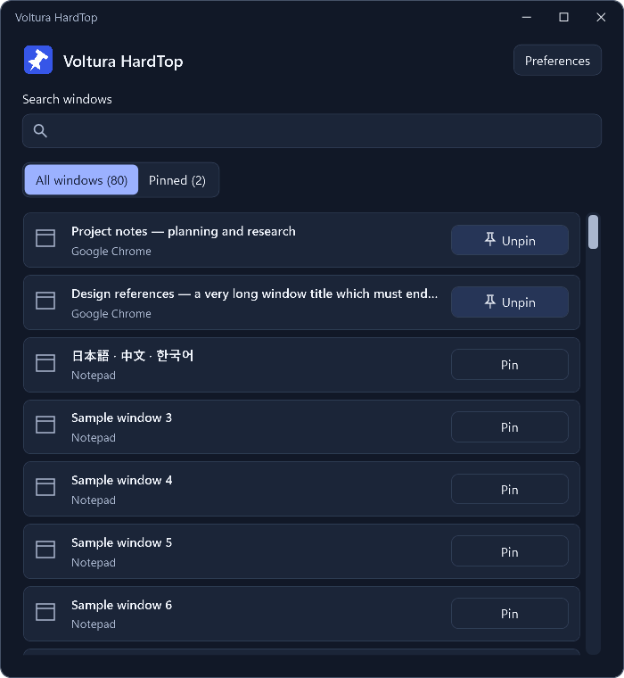

# Voltura HardTop

**Keep a window. Keep your focus.**

Pin the windows you need above the rest. A modern Windows tray companion built with C# and .NET 10.

[](https://github.com/voltura/voltura-hardtop/releases/latest)
[](https://github.com/voltura/voltura-hardtop/releases)
[](LICENSE)
[](https://hardtop.voltura.se/#download)
[](https://github.com/voltura/voltura-hardtop/issues)

**[Website](https://hardtop.voltura.se/)** · **[Watch the demo](https://www.youtube.com/watch?v=2ecOkoOEgUc)** · **[Download](https://github.com/voltura/voltura-hardtop/releases/latest)** · **[SourceForge](https://sourceforge.net/projects/voltura-hardtop/)** · **[Help](SUPPORT.md)**



## Use

- Click the tray icon or press **Ctrl+Alt+Z** to find a window. Search by title or application, then select **Pin**. Press **Ctrl+F** to focus search and select the current filter.
- Press **Ctrl+Alt+T** to toggle the active window directly. Both shortcuts are configurable.
- Use **Pinned** to see topmost windows. Closing HardTop's window keeps it beside the clock; **Exit** restores its own pin changes and closes the app.
- Choose from 21 languages, light/dark/system appearance, and optional startup with Windows.

Windows already made topmost by another app are left alone unless you change them. HardTop restores its own changes on graceful exit, not after a crash. It does not remember pins across restarts. Some elevated or protected windows cannot be controlled without matching permissions; HardTop does not elevate automatically.

## Install

For Windows x64 with .NET 10-supported Windows versions. Windows 11 is recommended; Windows 10 22H2 requires Microsoft's applicable servicing/ESU support.

Choose an installer from the [latest release](https://github.com/voltura/voltura-hardtop/releases/latest):

| Package | Runtime |
| --- | --- |
| **VolturaHardTop-Setup-1.0.3-win-x64.exe** | Includes .NET 10; works offline. |
| **VolturaHardTop-Setup-1.0.3-win-x64-lite.exe** | Smaller download; reuses .NET 10 Desktop x64 or downloads and installs it if missing. Internet and administrator approval may be needed for the shared runtime. |
| **VolturaHardTop-1.0.3-win-x64.zip** | Portable, includes .NET; extract into a writable folder. |

Both installers install HardTop for your Windows account and support verified automatic updates. Updates retain your chosen installer type. Avoid running the original HardTop and Voltura HardTop simultaneously because their default picker shortcut is the same.

Installed copies check GitHub for stable updates at startup and every 24 hours. Verified updates download automatically; you choose when to install. Turn automatic downloads off in Preferences. Portable copies can check for updates and open the download page; they do not download or install updates automatically. Locally self-signed builds can show Windows publisher warnings; self-signing is not public certificate trust.

## Build and release locally

Requires Windows x64, PowerShell 7, .NET SDK 10.0.403, NSIS 3, Git, GitHub CLI, and Windows SDK signing tools.

```powershell
./scripts/setup.ps1
./scripts/check.ps1
./scripts/build.ps1
./scripts/build.ps1 -FrameworkDependent
./scripts/package.ps1 -SkipBuild
```

Private signing keys stay outside Git. Published update keys must be preserved. Releases and installers are built locally, without GitHub Actions. See [release instructions](docs/releasing.md).

[1.0.3 changes](docs/release-1.0.3.md) · [1.0.2 changes](docs/release-1.0.2.md) · [Review record](docs/review-1.0.2.md) · [Validation](docs/validation-1.0.2.md)

## Project

This is a new application based on [original HardTop](https://github.com/voltura/HardTop). The original project and its data remain unchanged. [MIT license](LICENSE), copyright Voltura AB.

[Contribute](CONTRIBUTING.md) · [Security](SECURITY.md) · [Privacy](PRIVACY.md) · [Code of conduct](CODE_OF_CONDUCT.md)

If HardTop helps you, [support Voltura via PayPal](https://www.paypal.me/voltura) or [buy me a coffee](https://ko-fi.com/G2G74W5F8).

## Statistics

[](https://hits.sh/github.com/voltura/voltura-hardtop/)
[](https://github.com/voltura/voltura-hardtop)
[](https://github.com/voltura/voltura-hardtop/stargazers)
[](https://github.com/voltura/voltura-hardtop/forks)
[](https://github.com/voltura/voltura-hardtop/commits)
[](https://github.com/voltura/voltura-hardtop)
[](https://github.com/voltura/voltura-hardtop)
